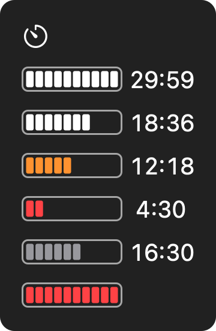

# bar-timer

A work timer for the macOS menu bar that shows the time left as a bar, so you can tell how
much is left from the corner of your eye without reading numbers.



## What it shows

The bar has 10 cells, and each cell stands for a tenth of the time you set (3 minutes of a
30-minute timer). Each time a tenth passes, the rightmost cell disappears.

| State | Looks like |
|---|---|
| Idle | A timer icon only. |
| Running | White cells while 6 or more are left, orange at 3 to 5, red at 2 or fewer. The time left is shown beside the bar (you can turn it off). |
| Paused | Gray cells. |
| Time up | A sound and a notification. The bar blinks red for a minute, then stays red until you open the menu or click or close the notification. |

Time is counted from the end time, so it keeps passing while the Mac sleeps, like a kitchen
timer.

## Install

There are no prebuilt downloads: an ad-hoc signed app downloaded from the internet is blocked
by Gatekeeper, so build it from source.

```bash
xcode-select --install   # if you don't have the Command Line Tools
git clone https://github.com/GoatEatAny/bar-timer.git
cd bar-timer
./build.sh install
```

This builds `BarTimer.app`, copies it to `~/Applications` and launches it. There is no Dock
icon; a timer icon appears in the menu bar.

- **Notifications.** macOS asks once whether to allow them (on recent versions the question
  itself arrives as a notification, so it is easy to miss). If you deny it, the app cannot ask
  again; the menu then shows **⚠️ Notifications Off — Open Settings…**, which opens the settings. The
  alert style defaults to persistent, so the notice stays until you close it. The sound and the
  blinking work without notifications.
- **Position.** macOS places new menu bar items to the left of existing ones. ⌘-drag the icon
  to where you want it; macOS remembers the place. No app can go right of Control Center and
  the clock.
- **Open at login.** System Settings → General → Login Items, click **+**, press ⌘⇧G, go to
  `~/Applications` and pick `BarTimer.app`. Rebuilding replaces the app in place, so the entry
  keeps working.

### Requirements

- **macOS 12 or later.** Tested on macOS 27 only.
- **Swift 5.9 or later**, from Xcode 15 or later or its Command Line Tools.

### If it does not show up

- Check that it is running: `pgrep -x BarTimer`. If it is running but you can't see it, the
  menu bar may be full and the icon hidden behind the notch.
- If it is not running, start `~/Applications/BarTimer.app/Contents/MacOS/BarTimer` from a
  terminal to see why it quits.
- If the build fails after a macOS update (`this SDK is not supported by the compiler`),
  reinstall the Command Line Tools.
- If notifications still show a blank icon after the first build, macOS has cached the old one.
  Log out and back in.

### Uninstall

```bash
pkill -x BarTimer
rm -rf ~/Applications/BarTimer.app
defaults delete io.github.goateatany.bartimer   # the one setting it keeps
```

Remove it from Login Items too if you added it.

## Use

Click the icon in the menu bar. The shortcuts work while the menu is open.

| Item | Key | What it does |
|---|---|---|
| 5 / 15 / 30 / 45 / 60 min | ⌘1–⌘5 | Starts a timer. Choosing one while running starts over. |
| Custom… | ⌘T | Asks for 1 to 600 minutes. Full-width digits (as typed by CJK input methods) work too. |
| Pause / Resume | ⌘P | Pauses or resumes. |
| Stop | | Stops and returns to idle. |
| Show Time Left | | Shows or hides the time beside the bar. Kept across launches. |
| Quit BarTimer | ⌘Q | Quits the app, and with it any running timer. |

The first line of the menu shows the time left and when it will end, and keeps counting while
the menu is open.

## Notes

- **One Swift file, no dependencies.** `Sources/main.swift` is the whole app; there is no Xcode
  project or Swift package. `build.sh` compiles it with `swiftc` and signs it ad hoc.
- **NSStatusItem rather than SwiftUI's MenuBarExtra.** MenuBarExtra may draw its label as a
  single-color template, which would lose the bar's colors.
- **The icon is drawn from code.** `icon.swift` draws it on every build and `iconutil` packs it,
  so the repository holds no image files for the app.
- **The time-entry panel is custom** because NSAlert left-aligns its icon and text from macOS 26
  on, with no way to center them.
- **Idle costs nothing.** The bar is redrawn every half second only while running or showing
  that time is up.

## Known limitations

- The white cells assume a dark menu bar. On a light one they are hard to see.
- Moving the Mac's clock by hand moves the end time with it.
- The menus and notifications are in English only.

## License

MIT.
